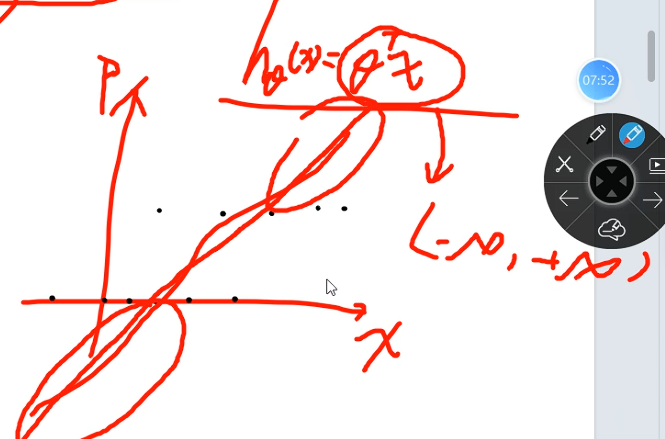

# Logistic-Softmax

解决**分类**任务，预测属于某一类别的**概率**【连续值】

eg. 若用**线性函数**拟合二分类任务的概率 $p$

设定二分类任务中：

> 正类 ： $p$
>
> 负类： $1 - p$

$x^{(0)}$  y = 正   $p = 1$  $\hat{p} = \theta^Tx^{(0)}$

$x^{(1)}$  y = 负   $p = 0$  $\hat{p} = \theta^Tx^{(1)}$

$x^{(2)}$  y = 正   $p = 1$  $\hat{p} = \theta^Tx^{(2)}$

...

容易产生线性函数值域 $(-\infty, +\infty)$ 超出概率范围 $p \in (0, 1)$ ：

### odds【几率】

$$
odds=\frac{p}{1-p} \in (0, +\infty)
$$

为了使得概率 $p$ 能变换匹配**线性**函数值域 $(-\infty, +\infty)$ ，**对odds几率取对数**，得到对数几率： $\log(odds)\in(-\infty, +\infty)$

$$
\begin{aligned}
\ln\left(\frac{p}{1-p}\right)&=\theta^Tx \\
\frac{p}{1-p}&=e^{\theta^Tx}\\
p &=\frac{e^{\theta^Tx}}{1+e^{\theta^Tx}}=\frac{1}{1+e^{-\theta^Tx}}\in (0, 1)
\end{aligned}
$$

### Logistic回归

Logistic/sigmoid函数 ：

$$
p =h_{\theta}(x)=g(\theta^Tx)=\frac{1}{1+e^{-\theta^Tx}}
$$

$$
\begin{aligned}
g(z)&=\frac{1}{1+e^{-z}},\ z\in(-\infty, +\infty) \\
g^\prime(z)&=\left(\frac{1}{1+e^{-z}}\right)^\prime=\frac{e^{-z}}{(1+e^{-z})^2}\\
&=\frac{1}{1+e^{-z}}\cdot\left(1-\frac{1}{1+e^{-z}}\right)\\
&=g(z)\cdot(1-g(z))
\end{aligned}
$$

注意：**多分类**问题可以用**OVR思想**转换成多个不同的Logistic回归【二分类问题】；不同的类别对应不同的参数 $\theta$

OVR分组求得的概率和不一定为1；OVR分组求得的不同类别的发生概率 $\hat p$ 哪个最大，就将其预测为哪个类别

#### Logistic回归及似然函数

对样本的标签做**伯努利分布**的建模：一次试验只有两种互斥结果（发生 / 不发生、正类 / 负类），概率和为 1

$$
\begin{cases}
P(y=1 \mid x;\theta) = h_\theta(x)\\
P(y=0 \mid x;\theta) = 1 - h_\theta(x)
\end{cases}
$$

注意：**后续Logistic回归的似然、梯度推导都建立该二分类的概率分布的假设的基础上**

对任意 $x^{(i)}$ 来说，**概率 $p$ 的统一表达式**：

$$
P(y \mid x;\theta) = \big(h_\theta(x)\big)^y \big(1 - h_\theta(x)\big)^{1-y}
$$

把m条数据观测结果的联合概率当作似然函数：

$$
\begin{aligned}
L(\theta) &= p(\vec{y} \mid X;\theta) = \prod_{i=1}^m p\big(y^{(i)} \mid x^{(i)};\theta\big) \\
&= \prod_{i=1}^m \left( h_\theta\big(x^{(i)}\big) \right)^{y^{(i)}} \left( 1 - h_\theta\big(x^{(i)}\big) \right)^{1-y^{(i)}}
\end{aligned}
$$

对似然函数求对数，得到对数似然函数：

$$
\ell(\theta) = \ln L(\theta) = \sum_{i=1}^m \left( y^{(i)} \ln h_\theta\big(x^{(i)}\big) + \big(1-y^{(i)}\big)\ln\big(1-h_\theta(x^{(i)})\big) \right)
$$

#### 极大似然的随机梯度

**目标**：求参数 $\theta$，使 $\ell(\theta)$ 最大（**最可能复现**样本结果）

先对 $\ell(\theta)$ 中的 $h_\theta\left(x^{(i)}\right)$ 求导，然后再对 $h_\theta\left(x^{(i)}\right)$ 中的 $\theta_j$ 求导。

由于 $p = h_{\theta}(x) = g(\theta^Tx) = \frac{1}{1+e^{-\theta^Tx}}$，下面用 $g(\theta^Tx^{(i)})$ 替代 $h_\theta\left(x^{(i)}\right)$：

$$
\begin{aligned}
\frac{\partial \ell(\theta)}{\partial \theta_j}
&= \sum_{i=1}^m \left( \frac{y^{(i)}}{h_\theta\left(x^{(i)}\right)} - \frac{1-y^{(i)}}{1-h_\theta\left(x^{(i)}\right)} \right) \cdot \frac{\partial h_\theta\left(x^{(i)}\right)}{\partial \theta_j} \\
&= \sum_{i=1}^m \left( \frac{y^{(i)}}{g\left(\theta^Tx^{(i)}\right)} - \frac{1-y^{(i)}}{1-g\left(\theta^Tx^{(i)}\right)} \right) \cdot \frac{\partial g\left(\theta^Tx^{(i)}\right)}{\partial \theta_j} \\
&= \sum_{i=1}^m \left( \frac{y^{(i)}}{g\left(\theta^Tx^{(i)}\right)} - \frac{1-y^{(i)}}{1-g\left(\theta^Tx^{(i)}\right)} \right) \cdot g\left(\theta^Tx^{(i)}\right) \cdot \left(1-g\left(\theta^Tx^{(i)}\right)\right) \cdot \frac{\partial \theta^Tx^{(i)}}{\partial \theta_j}
\end{aligned}
$$

注意：$\frac{\partial \theta^Tx^{(i)}}{\partial \theta_j}$ 可以理解成第i个样本第j个参数 $\theta$ 对应的特征值 $x_j^{(i)}$

$$
\frac{\partial \theta^Tx^{(i)}}{\partial \theta_j}=
\frac{\partial \left(\theta_0+\theta_1x_1+\cdots+\theta_ix_i\right)}{\partial \theta_j} = x_j^{(i)}
$$

因此，$\ell(\theta)$ 求导可以进一步优化：

$$
\begin{aligned}
\frac{\partial \ell(\theta)}{\partial \theta_j}
&= \sum_{i=1}^m \left( {y^{(i)}}\cdot{(1-g\left(\theta^Tx^{(i)}\right))} - {(1-y^{(i)})}\cdot{g\left(\theta^Tx^{(i)}\right)} \right) \cdot x_j^{(i)}\\
&= \sum_{i=1}^m \left( {y^{(i)}}-g\left(\theta^Tx^{(i)}\right)\right) \cdot x_j^{(i)}
\end{aligned}
$$

注意：直接对sigmoid函数 $g(\theta^Tx^{(i)})$ 求极值不好求，因此使用**梯度下降算法**求极大似然 $\ell(\theta)$ 的极大值

#### 极大似然估计与Logistic回归目标函数

由于在极大似然估计中，当似然函数最大的时候模型最优；而在机器学习 领域中，目标函数最小的时候，模型最优。因此，若求极大似然 $\ell(\theta)$ 的极大值，可取 $-\ell(\theta)$ 对应梯度下降算法中计算损失函数 $J(\theta)$ 的极小值，**Logistic回归目标函数**如下。

目标函数：

$$
J(\theta)=-\ell(\theta)=-\sum_{i=1}^m \left( y^{(i)} \ln h_\theta\big(x^{(i)}\big) + \big(1-y^{(i)}\big)\ln\big(1-h_\theta(x^{(i)})\big) \right)
$$

其中，$y^{(i)}$ 是事件发生的真实值；$\ln h_\theta\big(x^{(i)}\big)$ 是事件发生的预测概率值；$1-y^{(i)}$ 是事件不发生的真实值；$\ln\big(1-h_\theta(x^{(i)})\big)$ 是事件不发生的预测概率值

Logistic回归 $\theta$ 参数的求解过程【类似梯度下降算法】：

- 批量梯度下降

  用全部 m 个样本构造完整的似然函数作为目标函数。每一步的目标函数是固定的，梯度是确定的，下降路径平稳，和 “普通函数梯度下降” 的确定性是一致的

$$
\theta_j = \theta_j + \alpha \sum_{i=1}^{m} \left( y^{(i)} - h_\theta\left(x^{(i)}\right) \right) \cdot x_j^{(i)}
$$

注意：目标函数 $J(\theta)$ 前有负号，所以学习率 $\alpha$ 前为 $+$ 号

- 小批量梯度下降

  每次只取 1 个样本，用 “单样本的似然” 临时充当目标函数。每一步迭代的目标函数都不一样，梯度是真实梯度的带噪声估计 —— 这就是 SGD 随机性的本质：每一步都在优化一个略有不同的目标函数：

  - 所有正样本（y=1）都想把参数往 “预测概率变大” 的方向拉
  - 所有负样本（y=0）都想把参数往 “预测概率变小” 的方向拉

  最终的最优参数，就是正、负两类样本拉扯平衡的位置，此时**对数似然最大、分类总误差整体最小**

$$
\theta_j = \theta_j + \alpha \left( y^{(i)} - h_\theta\left(x^{(i)}\right) \right) \cdot x_j^{(i)}
$$

最终结果要的得到的预测值 $\hat y$ ——由最优参数 $\theta$ 组成的概率 $p$ 经过阈值确定属于正样本（y=1）还是负样本（y=0）。

$$
p =\frac{1}{1+e^{-\theta^Tx}} \in (0,\ 1)
$$

$$
\hat y=\begin{cases}
1,\ p\geq threshold\\
0,\ p< threshold
\end{cases}
$$

注意：

- 由于逻辑回归输出的是连续概率值 $p$ ，因此可以遍历 $(0,1)$ 区间内所有可能的阈值，计算出多组【假阳性率，真阳性率】，从而绘制出 ROC 曲线，并计算曲线下面积（AUC）来综合评估模型对不同类别的排序能力

- ROC 曲线不仅用来算 AUC 评估模型，其返回的 `thresholds` 数组可直接配合 TPR/FPR，通过约登指数（TPR - FPR）或固定召回率要求，**反推出最佳业务决策阈值【针对所有样本的阈值】**，从而实现从“评估”到“决策”的闭环

### Softmax回归

softmax回归是logistic回归的一般化，适用于K分类的问题，针对于**每个类别**都有一个参数向量 $\theta$，第k类的参数为**向量** $\theta_k$，组成的二维矩阵为 $\theta_{k*n}$

注意：使用OVR思想二分类分组求得的概率和不一定为1；OVR分组求得的不同类别的发生概率 $\hat p$ 哪个最大，就将其预测为哪个类别

softmax函数本质是将一个**k维**【不同类别】的任意实数向量压缩成另一个k维的实数向量，使得概率p满足以下两个条件：

$$
\hat y=\begin{cases}
0\leq p\leq1\\
\sum_{i=1}^{k} p_i=1
\end{cases}
$$

softmax回归概率函数为：

$$
p(y = k \mid x; \theta) = \frac{e^{\theta_k^T x}}{\sum_{l=1}^{k} e^{\theta_l^T x}}, \, k = 1,2 \cdots, k
$$

注意：

- 分子需要满足的条件：

  1. 单调

像图中【分子取绝对值、平方】，都可能会出现**两个类别概率一样**的问题

  2. 概率必须满足**非负性**【 $\geq0$】

- 其中的 $\theta_k^T$ 是对应类别的参数向量，其中包含对应特征的参数

使用该softmax回归概率函数表示每一个类别发生的概率（$n$：**输入特征向量 x 的维度**）：

$$
h_\theta(x) = \begin{bmatrix}
p(y^{(i)} = 1 \mid x^{(i)}; \theta) \\
p(y^{(i)} = 2 \mid x^{(i)}; \theta) \\
\vdots \\
p(y^{(i)} = k \mid x^{(i)}; \theta)
\end{bmatrix} = \frac{1}{\sum_{j=1}^k e^{\theta_j^T x^{(i)}}} \begin{bmatrix}
e^{\theta_1^T x} \\
e^{\theta_2^T x} \\
\vdots \\
e^{\theta_k^T x}
\end{bmatrix} \implies \theta = \begin{bmatrix}
\theta_{11} & \theta_{12} & \dots & \theta_{1n} \\
\theta_{21} & \theta_{22} & \dots & \theta_{2n} \\
\vdots & \vdots & \ddots & \vdots \\
\theta_{k1} & \theta_{k2} & \dots & \theta_{kn}
\end{bmatrix}
$$

#### 参数 $\theta$ 求解

##### 1. softmax 目标函数

使用负的似然函数 $-\ell(\theta)$。通过极大似然估计得到似然函数：对 m 个样本**真实标签中观测到**的概率求乘积，取对数、取平均并加负号，得到 **最小化**目标 $J(\theta)$：

$$
\begin{aligned}
J(\theta) &= -\frac{1}{m}\ln\left( \prod_{i=1}^{m} \sum_{j=1}^{k} I\left(y^{(i)} = j\right) \cdot \frac{e^{\theta_{j}^{T}x^{(i)}}}{\sum_{l=1}^{k}e^{\theta_{l}^{T}x^{(i)}}} \right) \\
&= -\frac{1}{m} \sum_{i=1}^{m} \sum_{j=1}^{k} I\left(y^{(i)} = j\right) \cdot \ln\left(\frac{e^{\theta_{j}^{T}x^{(i)}}}{\sum_{l=1}^{k}e^{\theta_{l}^{T}x^{(i)}}}\right)
\end{aligned}
$$

**Softmax 预测概率**（后文统一记作 $p_j^{(i)}$）

$$
p_j^{(i)} = P(y=j \mid x^{(i)};\theta) = \frac{e^{\theta_j^T x^{(i)}}}{\sum_{l=1}^{k} e^{\theta_l^T x^{(i)}}}
$$

**指示函数**（$j$ 表示「正在检查第 $j$ 类是不是真实类」）

$$
I\left(y^{(i)} = j\right) = \begin{cases}
1, & y^{(i)} = j \\
0, & y^{(i)} \neq j
\end{cases}
$$

- **含义**：固定样本 $i$、遍历类别 $j$ 时，$I$ 只判断一件事：**「$j$ 是不是这条样本的真实类？」** 是则 $1$，否则 $0$

- **one-hot 性质**：一条样本只有一个真实标签 $y^{(i)}$，所以在 $k$ 个类别 $j$ 中 **恰有一个 $I=1$，其余 $k-1$ 个全是 $0$**；等价于

$$
\sum_{j=1}^{k} I\left(y^{(i)} = j\right) = 1
$$

例：真实类为恶性时 $I=1$，为良性时 $I=0$。

- **在目标函数里的作用**：内层 $\sum_{j=1}^{k}$ 形式上对 $k$ 类各写一项，但 $I$ 把非真实类全部乘成 $0$，只留真实类：

$$
\sum_{j=1}^{k} I\left(y^{(i)} = j\right) \cdot \ln p_j^{(i)}
= \ln p_{y^{(i)}}^{(i)}
= \ln P\big(y=y^{(i)} \mid x^{(i)};\theta\big)
$$

即 $I$ 是 **「只取真实类概率的对数」** 的开关；最小化 $J(\theta)$ 等价于让每个样本的真实类预测概率尽量大。

- **单样本损失**（略去系数 $-\frac{1}{m}$）：

$$
J^{(i)} = -\ln p_{y^{(i)}}^{(i)} = -\ln\left(\frac{e^{\theta_{y^{(i)}}^T x^{(i)}}}{\sum_{l=1}^{k}e^{\theta_l^T x^{(i)}}}\right)
$$

**→ 衔接第 2 节**：全量目标 $J(\theta)$ 是对 $m$ 条样本的 $J^{(i)}$ 取平均。后续求导 **针对其中一条样本** $i$，把 $J^{(i)}$ 对各行参数 $\theta_j$ 求偏导；第 3 节再讨论如何用这些偏导 **更新** 参数矩阵 $\Theta$。

##### 2. 对 softmax 目标函数 $J(\theta)$ 求导

**本节视角**：固定 **一条样本** $(x^{(i)}, y^{(i)})$，对 **每一行** 参数 $\theta_j$ 求偏导（全批量时对 $i=1,\ldots,m$ 求和，放在第 3 节 **批量梯度下降** 里讲）

**Step 1　先将 $J^{(i)}=-\ln p_{y^{(i)}}^{(i)}$ 拆成两项**

$$
\begin{aligned}
J^{(i)} = -\theta_{y^{(i)}}^T x^{(i)} + \ln\sum_{l=1}^{k} e^{\theta_l^T x^{(i)}}
\end{aligned}
$$

第一项（numerator，分子项）只含真实类参数 $\theta_{y^{(i)}}$；第二项（归一化项 / log-sum-exp）是公共分母，含所有类参数。

| 项                                  | 式子里出现哪些 $\theta$                 | 与求导下标 $j$ 的关系                                        | 含义                                                         |
| ----------------------------------- | --------------------------------------- | ------------------------------------------------------------ | ------------------------------------------------------------ |
| $-\theta_{y^{(i)}}^T x^{(i)}$       | **仅** 真实类那一行 $\theta_{y^{(i)}}$  | 只有 $j=y^{(i)}$ 时，该项才含 $\theta_j$；$j\neq y^{(i)}$ 时与 $\theta_j$ **无关** | $I$ 筛选的结果：线性分数只通过 **真实类对应的那一行** 进入损失 |
| $+\ln\sum_l e^{\theta_l^T x^{(i)}}$ | **每一行** $\theta_l$（$l=1,\ldots,k$） | 对 **任意** $j$，$\theta_j$ 都在 $Z^{(i)}$ 里                | 公共分母；改任意一行 $\theta_j$ 都会改变所有 $p_l^{(i)}$ |

**读表要点**：求导时的 $j$ 是「正在对 **第 $j$ 行** 求偏导」；$y^{(i)}$ 是「这条样本 **真实类是第几行**」。二者相等时，分子项才有 $-x^{(i)}$；归一化项则 **无论 $j$ 是否等于 $y^{(i)}$ 都会有贡献**。

**Step 2　对第 $j$ 行 $\theta_j$ 求导**

分别对两项求偏导，再相加。

**（1）分子项** $-\theta_{y^{(i)}}^T x^{(i)}$

这里 $y^{(i)}$ 是 **固定的真实类**，不随求导下标 $j$ 变化。

- 若 $j=y^{(i)}$（正在对 **真实类那一行** 求导）：$\theta_j$ 就是 $\theta_{y^{(i)}}$，导数为 $-x^{(i)}$。
- 若 $j\neq y^{(i)}$（正在对 **非真实类行** 求导）：式中不含 $\theta_j$，导数为 $0$。

合并写法：

$$
-I(y^{(i)}=j)\,x^{(i)}
$$

**（2）归一化项** $\ln\sum_{l=1}^{k} e^{\theta_l^T x^{(i)}}$（log-sum-exp）

记 $Z^{(i)}=\sum_{l=1}^{k} e^{\theta_l^T x^{(i)}}$，则 $\ln Z^{(i)}$ 对 $\theta_j$ 用链式法则：

$$
\begin{aligned}
\frac{\partial}{\partial \theta_j}\ln Z^{(i)}
&= \frac{1}{Z^{(i)}}\cdot \frac{\partial Z^{(i)}}{\partial \theta_j} \\
&= \frac{1}{Z^{(i)}}\cdot e^{\theta_j^T x^{(i)}}\cdot x^{(i)} \\
&= \frac{e^{\theta_j^T x^{(i)}}}{\sum_l e^{\theta_l^T x^{(i)}}}\,x^{(i)}
= p_j^{(i)}\,x^{(i)}
\end{aligned}
$$

**关键**：此项对 **每一个** $j$ 都存在（含 $j\neq y^{(i)}$ 的非真实类行），因为 $Z^{(i)}$ 的分母里含有 **所有类** 的 $\theta_l$。这就是非真实类行梯度 **不为 $0$** 的原因——不是 $I$ 失效，而是公共分母把各类参数耦合在一起。

**（3）两项合并**

| 情况                          | 分子项     | 归一化项           | 合计                     |
| ----------------------------- | ---------- | ------------------ | ------------------------ |
| $j=y^{(i)}$（真实类行）       | $-x^{(i)}$ | $p_j^{(i)}x^{(i)}$ | $(p_j^{(i)}-1)\,x^{(i)}$ |
| $j\neq y^{(i)}$（非真实类行） | $0$        | $p_j^{(i)}x^{(i)}$ | $p_j^{(i)}\,x^{(i)}$     |

**统一写法**（$I$ 只决定 $-x^{(i)}$ 是否出现）：

$$
\nabla_{\theta_j} J^{(i)} = \left(p_j^{(i)} - I(y^{(i)}=j)\right) x^{(i)}
$$

最小化 $J$ 时梯度下降（单样本、单行 $j$）：

$$
\begin{aligned}
\theta_j &\leftarrow \theta_j - \alpha\left(p_j^{(i)} - I(y^{(i)}=j)\right)x^{(i)} \\
&= \theta_j + \alpha\left(I(y^{(i)}=j) - p_j^{(i)}\right)x^{(i)}
\end{aligned}
$$

**在参数矩阵里长什么样**

上式更新的是 $\Theta$ 的 **第 $j$ 行**（一个长度为 $n$ 的行向量）。记 $\Delta\theta_j = \alpha(I-p_j^{(i)})x^{(i)}$，则 **第 $j$ 行每个特征维度** 同步加上 $x^{(i)}$ 的对应分量（乘以标量系数）：

$$
\begin{aligned}
\begin{bmatrix} \theta_{j1} & \theta_{j2} & \cdots & \theta_{jn} \end{bmatrix} &\leftarrow \begin{bmatrix} \theta_{j1} & \theta_{j2} & \cdots & \theta_{jn} \end{bmatrix} \\
&\quad + \alpha\left(I(y^{(i)}=j) - p_j^{(i)}\right) \begin{bmatrix} x_1^{(i)} & x_2^{(i)} & \cdots & x_n^{(i)} \end{bmatrix}
\end{aligned}
$$

注：对 **一条样本**，要对 **所有** $j=1,\ldots,k$ 各做一次上述「整行更新」——即 $\Theta$ 的 **每一行** 都改，不是只改真实类那一行。

**小结：固定 1 条样本，看各行参数**

下表就是 **随机梯度下降（SGD）每抽 1 条样本时** 对各行的更新逻辑：

| 参数行 $j$                 | $I$  | 更新量 $\propto$         | 效果                           |
| -------------------------- | ---- | ------------------------ | ------------------------------ |
| 真实类行 $j=y^{(i)}$       | $1$  | $(1-p_j^{(i)})\,x^{(i)}$ | **拉近**（$p_j<1$ 时系数为正） |
| 非真实类行 $j\neq y^{(i)}$ | $0$  | $(-p_j^{(i)})\,x^{(i)}$  | **推远**（系数恒为负）         |

**一条样本**：真实类 **那一行拉近**，其余行 **推远**。eg. 抽中 1 条 **恶性** 样本 → 样本内对于 $\theta_{\mathrm{mal}}$、$\theta_{\mathrm{ben}}$ 的更新：$\theta_{\mathrm{mal}}$ 拉近、$\theta_{\mathrm{ben}}$ 推远，**两行同时更新**。

##### 3. 代入梯度下降，更新参数

**本节要解决的问题**：第 2 节的公式里只有 **一条** 样本 $i$。实际训练时有 $m=699$ 条样本，需要决定——**每次更新用哪几条样本的梯度？** 两种标准做法：

|                 | 随机梯度下降（SGD）                | 批量梯度下降（BGD）            |
| --------------- | ---------------------------------- | ------------------------------ |
| 每次用几条      | **1 条**                           | **全部 699 条**                |
| 与第 2 节的关系 | 直接套用单样本式                   | 对 $i=1,\ldots,699$ 求和后套用 |
| 视角            | 固定 1 条样本，看各行（同第 2 节） | 固定 1 行参数，看 699 条样本   |

下面 **先讲 SGD，再讲 BGD**，最后汇总 **参数矩阵的最终更新形式**。

**随机梯度下降（SGD）**

**做法**：每次随机（或按顺序）抽 **1 条** 样本 $i$，直接用第 2 节公式 **立刻** 更新 **每一行** $\theta_j$：

$$
\theta_j \leftarrow \theta_j + \alpha\left(I(y^{(i)}=j) - p_j^{(i)}\right)x^{(i)}, \qquad j=1,\ldots,k
$$

**执行逻辑**：

> 1. 每抽 1 条样本 $(x^{(i)}, y^{(i)})$
> 2. 算 Softmax，得所有 $p_j^{(i)}$；
> 3. 对 **每一行** $j$：用 $(I-p_j^{(i)})x^{(i)}$ 更新该行 $n$ 个参数：
> 4. 立刻写入 $\theta$，再抽下一条样本

**Epoch**：699 条样本各被用过一遍 ≈ **699 次** 上述单步更新 = **1 个 Epoch**。

注意：通常需 **很多 Epoch**，让大量单步的拉近/推远 **叠加**，才逼近 BGD 的全量方向。

**批量梯度下降（BGD）**

**从 SGD 到 BGD**：SGD 每步只用 1 条样本的梯度；BGD 则是 **单个 Epoch 先把 699 条样本的梯度全部加起来**，再更新一次。

对第 $j$ 行，全批量梯度为：

$$
\nabla_{\theta_j} J(\theta) = \frac{1}{m}\sum_{i=1}^{m}\left(p_j^{(i)} - I(y^{(i)}=j)\right)x^{(i)}
$$

更新（最小化 $J$）：

$$
\theta_j \leftarrow \theta_j + \alpha\sum_{i=1}^{m}\left(I(y^{(i)}=j) - p_j^{(i)}\right)x^{(i)}
$$

（等价于 $\theta_j - \alpha\,\nabla_{\theta_j} J(\theta)$；系数 $\frac{1}{m}$ 已吸收进学习率 $\alpha$ 时可省略写法差异。）

**执行逻辑**：

> 1. 固定 $j$（如良性行），对 $i=1,\ldots,699$ 累加 $\sum_i (I-p_j^{(i)})x^{(i)}$——这是 **$n$ 维向量**（9 个特征方向各自有一个总和）；
> 2. **一次性** 把该向量加到第 $j$ 行：$\theta_{\mathrm{ben},1},\ldots,\theta_{\mathrm{ben},9}$ 同时更新；
> 3. 换 $j$ 为恶性类，重复 1–2

一轮 Epoch：每个类别 $j$ 各做一次「699 条加总 → 更新整行」；共 $k$ 次行更新（$k=2$ 时更新良性行、恶性行各一次）。

注意：通常需 多轮 Epoch 直至收敛；**每轮、每行只做一次全量更新**。
